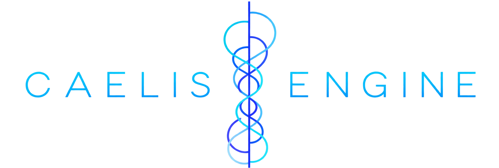
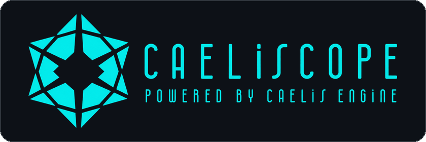
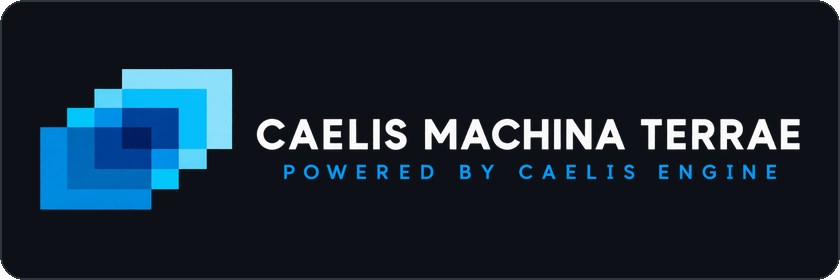
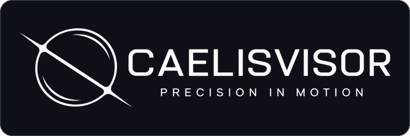
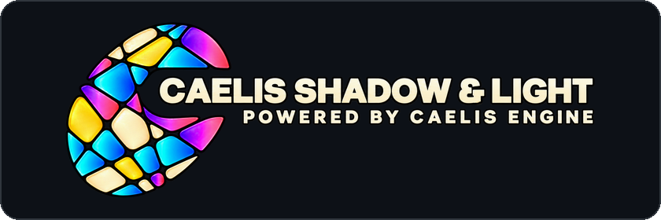
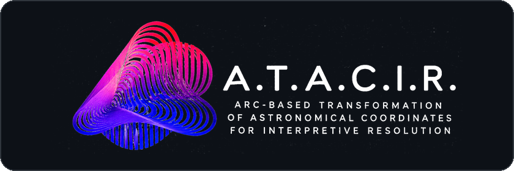
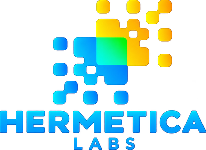

<p align="center">
  
</p>

<h1 align="center">Caelis Engine</h1>

<p align="center">
  Motor de cálculo astronómico determinista para JavaScript.<br>
  VSOP87B + ELP/MPP02-LLR · Sin servidor · Sin clave de API · Sin dependencias
</p>

<p align="center">
  <a href="https://www.npmjs.com/package/caelis-engine"></a>
  <a href="https://www.npmjs.com/package/caelis-engine"></a>
  <a href="https://github.com/HermeticaLabs/caelis-engine/stargazers"></a>
  <a href="https://github.com/HermeticaLabs/caelis-engine/blob/main/LICENSE"></a>
  <a href="https://hermeticalabs.github.io/caelis-engine/"></a>
  <a href="https://github.com/HermeticaLabs/caelis-engine/actions/workflows/validate.yml"></a>
</p>

<p align="center">
  <a href="https://github.com/HermeticaLabs/caelis-engine/blob/main/README.md">English</a> · <b>Español</b>
</p>

> **Motor v4.0.13 · Schema v3.1** — números de versión independientes. El Schema v3.1 define el contrato de salida y es estable entre parches del motor.
>
> **Qué cambió en v4.0.13:** mejora de las matemáticas dinámicas de ΔT (Delta T) y una corrección del tiempo sidéreo: `gast()` ahora usa UT1 para el término de rotación terrestre (las versiones anteriores le pasaban un valor TT, un desfase de ΔT × la tasa sidérea, unos 0.29° hoy). `meta.sidereal.gast_deg`, `lst_deg` y los valores derivados de ellos (como las coordenadas horizontales) cambian en consecuencia. Los valores de nutación (`delta_psi_arcsec`, `delta_eps_arcsec`) también difieren de la v4.0.12. Esto alteró algunas mecánicas del motor.
>
> **Estado de la documentación:** la carpeta `docs/` está siendo auditada y actualizada para reflejar los cambios de la v4.0.13, que aún no están documentados. La documentación se publicará una vez estabilizada la v4.0.13, sin cambio de versión. Mientras tanto, el código fuente y la suite de validación son la referencia.
>
> **Nota de actualización:** las versiones ≤ 4.0.7 contienen un error de unidades (minutos de arco → grados) en la refracción atmosférica que inflaba `alt_apparent_deg` (corregido en v4.0.8). Consulta [`CHANGELOG.md`](https://github.com/HermeticaLabs/caelis-engine/blob/main/CHANGELOG.md) para el historial completo de versiones.

**Cada número que produce este motor puede rastrearse hasta un modelo astronómico conocido, con precisión declarada y cero supuestos ocultos.**

Caelis Engine es un motor de cálculo determinista para datos celestes. Reemplaza las APIs opacas y los cálculos de caja negra por un sistema auditable, reproducible y autocontenido — que corre íntegramente en el navegador o en Node.js, sin servidor, sin clave de API, sin archivos de efemérides y sin dependencias.

```json
{
  "schema_version": "3.1",
  "meta": {
    "jd_tt": 2461193.499437,
    "frame": {
      "planets":  "VSOP87B (Bretagnon & Francou 1987)",
      "moon":     "ELP/MPP02-LLR · 164L+105B+29R terms",
      "nutation": "IAU 2000B · 77 luni-solar terms"
    }
  },
  "bodies": {
    "Sol":     { "lon_ecl_geocentric_deg": 71.498, "alt_geometric_deg": -27.896, "above_horizon": false },
    "Luna":    { "lon_ecl_geocentric_deg": 269.330, "lon_ecl_topocentric_deg": 270.082, "dist_km": 388954 },
    "Jupiter": { "lon_ecl_geocentric_deg": 114.254, "alt_geometric_deg": 8.267, "above_horizon": true }
  }
}
```

---

## El problema

La mayoría de las plataformas que trabajan con datos celestes dependen de:

- APIs de terceros con lógica interna opaca
- Resultados que no se pueden auditar ni reproducir de forma independiente
- Costos de infraestructura que crecen con el uso
- Una dependencia que no controlas — y que no puedes inspeccionar

Cuando algo devuelve un número incorrecto, no hay forma de saber por qué. Cuando la API cambia, tu producto se rompe. Cuando el servicio cae, caes con él.

---

## La solución

Caelis Engine te da control total sobre tu capa de cálculo celeste.

- **Determinista** — misma entrada, misma salida. Siempre. Demostrablemente.
- **Auditable** — cada algoritmo declarado en `meta.frame`. Cada número rastreable hasta su fuente.
- **Autocontenido** — corre en el navegador, en Node.js, en funciones edge, offline. No requiere backend.
- **Schema estable** — salidas JSON versionadas con garantías de compatibilidad a largo plazo.
- **Cero dependencias** — un solo archivo JavaScript. Sin instalación, sin paso de compilación, sin red.

Esto no es una API. Es un protocolo — con un contrato, invariantes y garantías verificables.

Es aquello sobre lo que se construyen los productos.

---

## Quién construye con Caelis Engine

**Aplicaciones de posicionamiento** — cualquier producto que necesite posiciones planetarias y lunares reales sin costos de suscripción ni límites de uso. Funciona 100% offline en el dispositivo del usuario. Ningún dato sale del cliente.

**Herramientas de astronomía y educación** — planificación de observaciones, simuladores de cielo, planetarios interactivos. La salida determinista implica resultados reproducibles en cualquier dispositivo, en cada ejecución.

**Infraestructura de datos y pipelines de IA** — cualquier sistema donde los datos celestes deban ser consistentes, trazables e inequívocos. Sin campos nulos, sin estados implícitos.

**Juegos y experiencias interactivas** — sistemas de cielo procedural, lógica de calendario lunar, mecánica celeste. Distribución en un solo archivo. Funciona offline. No requiere paso de compilación.

---

## Construido con Caelis Engine

Demos en vivo y aplicaciones construidas sobre el motor, cada una en su propio repositorio.

| | Proyecto | Estado |
|---|---|---|
| <a href="https://github.com/HermeticaLabs/Caeliscope"></a> | <a href="https://github.com/HermeticaLabs/Caeliscope"><b>Caeliscope</b></a><br>Visor inmersivo del cielo: viaja desde el espacio hasta cualquier punto de la Tierra y mira hacia arriba. Primera prueba técnica construida sobre Caelis Engine. | Disponible |
| <a href="https://github.com/HermeticaLabs/caelis-machina-terrae"></a> | <a href="https://github.com/HermeticaLabs/caelis-machina-terrae"><b>Caelis Machina Terrae</b></a><br>Aplicación armilar de representación por capas sincronizadas con Caelis Engine: dinámicas magnéticas (MMW), dinámicas telúricas (USGS), hídrico, viento solar y más. | Próximamente |
| <a href="https://github.com/HermeticaLabs/CaelisVisor"></a> | <a href="https://github.com/HermeticaLabs/CaelisVisor"><b>CaelisVisor</b></a><br>Seguimiento celeste pensado para telescopios y monturas. | Próximamente |
| <a href="https://github.com/HermeticaLabs/caelis-shadow-and-light"></a> | <a href="https://github.com/HermeticaLabs/caelis-shadow-and-light"><b>Caelis Shadow &amp; Light</b></a><br>Visualizador de luz y sombra solar en terreno urbano, con herramientas de análisis de luz. | Próximamente |
| <a href="https://github.com/HermeticaLabs/ATACIR"></a> | <a href="https://github.com/HermeticaLabs/ATACIR"><b>A.T.A.C.I.R.</b></a><br>Módulo de cálculos derivados (múltiples capas astrológicas) construido sobre las instantáneas de Caelis Engine. Proyecto independiente. | Próximamente |

---

## Arquitectura

```
TimeEngine → AstroCore
```

Dos capas. Una sola dirección. Separación estricta de responsabilidades.

### TimeEngine

El único módulo que lee `Date.now()`. Calcula JD, ΔT, GAST, LST y el estado del observador. Todos los demás módulos reciben el tiempo como parámetro explícito.

### AstroCore

Recibe el tiempo de TimeEngine. Calcula el estado físico del sistema solar. Devuelve una instantánea astronómica pura — schema v3.1.

Cero conceptos interpretativos. El motor no interpreta el cielo. Lo mide.

La interpretación pertenece a las aplicaciones construidas sobre el motor, nunca al motor mismo.

---

## Qué calcula

Las cifras de precisión a continuación son los límites algorítmicos publicados para cada modelo astronómico subyacente (VSOP87B, ELP/MPP02-LLR, etc.) — no una medición de la precisión de esta implementación. La precisión validada de la implementación se documentará, con metodología y resultados, una vez completada la auditoría de la documentación (ver la nota de estado al inicio).

| Cálculo                   | Algoritmo                                                                        | Límite algorítmico de precisión |
|---------------------------|----------------------------------------------------------------------------------|---------------------------------|
| Planetas Mercurio–Neptuno | VSOP87B (Bretagnon & Francou 1987)                                               | < 1′                            |
| Posición de la Luna       | ELP/MPP02-LLR · 164L+105B+29R términos                                           | < 10″                           |
| Nutación                  | IAU 2000B · 77 términos lunisolares                                              | < 1 mas                         |
| Oblicuidad                | IAU 2006 (Capitaine et al.)                                                      | < 0.001°                        |
| Corrección por tiempo luz | Iterativa · C = 173.14 UA/día                                                    | —                               |
| Aberración anual          | κ = 9.9365×10⁻⁵ rad                                                              | —                               |
| Paralaje lunar            | Topocéntrico completo · WGS-84                                                   | máx ~57′                        |
| Refracción atmosférica    | Sæmundsson (1986) · inversa de Bennett (1982), coincide en ~0.1′ · atmósfera ISA | ±0.1′ > 15°                     |
| ΔT                        | Polinomios de Espenak & Meeus (2006) antes de 1973 · tabla USNO observada/predicha 1973–2150 · cola parabólica continua después de 2150 | —                               |
| Tiempo sidéreo            | GAST IAU 2006 · UT1 para la rotación terrestre, TT para el polinomio y la nutación | —                               |
| Nodos lunares             | Meeus Cap.47                                                                     | —                               |

Cada instantánea contiene tanto la altitud geométrica como la aparente. Cada campo nombra su propio marco de coordenadas. Cada algoritmo se declara en `meta.frame`.

---

## Instalación

```bash
npm install caelis-engine
```

O usa la implementación de referencia en un solo archivo: [`caelis-minimal.html`](https://github.com/HermeticaLabs/caelis-engine/blob/main/caelis-minimal.html) — ábrelo con cualquier servidor local, sin instalación.

> **Modos de API:**
>
> - `setObserver()` + `getSnapshot()` — API conveniente con estado. El observador se configura una vez y se llama repetidamente. No es pura en sentido funcional — depende de estado global.
> - `getSnapshotAt(jd_tt, observer)` — API determinista explícita. Sin estado global. Los mismos argumentos siempre producen la misma salida.

## Inicio rápido

### Opción A — Archivo único

Descarga `caelis-minimal.html` desde este repositorio y ábrelo con un servidor local:

```bash
python -m http.server 8080
# abre http://localhost:8080/caelis-minimal.html
```

Sin instalación. Sin dependencias. Sin paso de compilación.

### Opción B — Node.js o bundler

```js
import { getSnapshot, getSnapshotAt, setObserver }
  from 'caelis-engine';

// Definir observador — Santiago, Chile
setObserver(-33.45, -70.66);

// Estado celeste actual
const snapshot = getSnapshot();

console.log(snapshot.bodies.Sol.lon_ecl_geocentric_deg);  // longitud eclíptica
console.log(snapshot.bodies.Sol.alt_geometric_deg);       // altitud geométrica
console.log(snapshot.bodies.Luna.dist_km);                // distancia lunar
console.log(snapshot.meta.obliquity.true_deg);            // oblicuidad verdadera
console.log(snapshot.meta.frame.planets);                 // declaración del algoritmo
```

### Opción C — Cualquier época, cualquier lugar

```js
// J2000.0 desde Londres — totalmente determinista
const j2000 = getSnapshotAt(2451545.0, { lat_deg: 51.5, lon_deg: -0.1 });

// 10-abr-1987 desde París — época de referencia de Meeus Cap.25
const meeus = getSnapshotAt(2446895.5, { lat_deg: 48.8, lon_deg: 2.3 });
```

---

## Schema de salida v3.1

El schema es el contrato. Estable, versionado y con garantía de no romperse entre versiones menores.

```json
{
  "schema_version": "3.1",
  "meta": {
    "jd_tt":       2461193.499437,
    "jd_utc":      2461193.498636,
    "utc":         "2026-06-01T23:58:02.191Z",
    "delta_t_sec": 69.17,
    "observer":    { "lat_deg": -33.45, "lon_deg": -70.66 },
    "frame": {
      "nutation":                "IAU 2000B (77 luni-solar terms + fixed planetary offsets, Mathews et al. 2002)",
      "obliquity":               "IAU 2006 (Capitaine et al. 2006)",
      "planets":                 "VSOP87B (Bretagnon & Francou 1987) + Meeus App.II",
      "moon":                    "ELP/MPP02-LLR (Chapront & Francou 2002) 164L+105B+29R",
      "delta_t":                 "Espenak & Meeus (2006) polynomials before 1973 AD + USNO observed/predicted table 1973-2150 AD + parabola anchored to the table after 2150 AD",
      "aberration":              "Annual (κ=9.9365e-5, Meeus Ch.23)",
      "refraction":              "Saemundsson (1986), ISA standard atmosphere",
      "above_horizon_criterion": "geometric (unrefracted)"
    },
    "sidereal":  { "gast_deg": 249.98872, "lst_deg": 179.32872 },
    "obliquity": { "mean_deg": 23.435843, "true_deg": 23.437975 },
    "nutation":  { "delta_psi_arcsec": 6.6344, "delta_eps_arcsec": 7.6757 }
  },
  "bodies": {
    "Sol": {
      "ra_deg":                 69.959,
      "dec_deg":                22.160,
      "lon_ecl_geocentric_deg": 71.499,
      "lat_ecl_geocentric_deg": -0.00012,
      "alt_geometric_deg":      -27.659,
      "alt_apparent_deg":       -27.659,
      "az_deg":                 279.448,
      "above_horizon":          false,
      "dist_au":                1.01404
    },
    "Luna": {
      "lon_ecl_geocentric_deg":  269.330,
      "lon_ecl_topocentric_deg": 270.082,
      "alt_geometric_deg":       14.160,
      "alt_apparent_deg":        14.225,
      "dist_km":                 406120
    }
  },
  "luna": {
    "phase_ratio":  0.894,
    "phase_deg":    160.99,
    "illumination": 0.973
  }
}
```

> El ejemplo anterior es salida real de Caelis Engine v4.0.13 (schema v3.1) para `jd_tt` 2461193.499437 y el observador indicado. Respecto a la v4.0.12, la v4.0.13 modifica `delta_t_sec`, la nutación (`delta_psi_arcsec`, `delta_eps_arcsec`), los campos sidéreos (`gast_deg`, `lst_deg`) y todas las cantidades derivadas de ellos, como altitud y acimut. La estructura no cambió. La especificación completa forma parte de la documentación actualmente en auditoría.

---

## ¿Por qué no una API de terceros o Swiss Ephemeris?

|                                      | APIs de terceros | Swiss Ephemeris | **Caelis Engine** |
|--------------------------------------|:----------------:|:---------------:|:-----------------:|
| Corre en el navegador                | ✗                | ✗               | **✓**             |
| No requiere servidor                 | ✗                | ✗               | **✓**             |
| Sin clave de API ni costo            | ✗                | ✓               | **✓**             |
| Precisión declarada por campo        | ✗                | parcial         | **✓**             |
| Algoritmo nombrado en cada salida    | ✗                | ✗               | **✓**             |
| Un solo archivo JS · sin instalación | ✗                | ✗               | **✓**             |
| Funciona offline                     | ✗                | ✓               | **✓**             |
| Salida versionada con schema estable | ✗                | ✗               | **✓**             |

Las APIs de terceros añaden latencia, costo y una dependencia que no controlas. Swiss Ephemeris es el estándar de precisión — pero requiere un servidor, un wrapper en C y archivos de efemérides.

Caelis Engine corre donde ninguna de las dos puede: directamente en el navegador, en funciones edge, en React Native, en cualquier entorno JavaScript. Offline. De forma determinista.

---

## Validación

```bash
node validation/run.js
```

La suite de validación contrasta el motor con épocas de referencia publicadas e invariantes del schema:

| Época / grupo                                | Fuente                                 |
|----------------------------------------------|----------------------------------------|
| J2000.0 — 2000-ene-01 12:00 TT               | IAU SOFA + paper VSOP87                |
| 10-abr-1987 (Meeus Cap.25)                   | Meeus *Astronomical Algorithms* 2ª ed. |
| 12-abr-1992 (Meeus Cap.33 Venus)             | Tabla de verificación VSOP87           |
| 2026-jun-01 línea base de regresión          | Salida canónica Caelis v4.0            |
| Invariantes del schema v3.1                  | Contrato de arquitectura               |
| Regresión de refracción atmosférica          | Fórmula de Sæmundsson, arcmin→grados   |

---

## Precisión y limitaciones

Diseñado para portabilidad y auditabilidad — no para astrometría sub-arcosegundo.

| Fuente                         | Error máximo declarado |
|--------------------------------|------------------------|
| VSOP87B (Urano, Neptuno)       | < 1′                   |
| ELP/MPP02 (Luna)               | < 10″                  |
| Nutación IAU 2000B             | < 1 mas                |
| Refracción cerca del horizonte | 1–5′                   |
| ΔT fuera del rango observado (1973–2026.75) | crece con la distancia a los datos; no se señala en la instantánea |

Escalas de tiempo: el motor no tiene tablas de DUT1 ni de segundos intercalares; UT1 se toma igual a UTC (se desprecia |UT1 − UTC| < 0.9 s).

Para requisitos sub-arcosegundo, usa JPL Horizons o Swiss Ephemeris con VSOP87 completo. Para todo lo que necesite correr en un navegador, offline y de forma determinista — esto es.

---

## Documentación

La documentación técnica (`docs/`) está **siendo auditada y actualizada** tras los cambios recientes del motor en la v4.0.13 (mejora de las matemáticas dinámicas de ΔT). Esos cambios modificaron algunas mecánicas y aún no están documentados.

Una vez estabilizada la v4.0.13, la documentación auditada se publicará en este repositorio **sin cambio de versión**.

Mientras tanto:

- [`CHANGELOG.md`](https://github.com/HermeticaLabs/caelis-engine/blob/main/CHANGELOG.md) — historial de versiones
- [`validation/`](https://github.com/HermeticaLabs/caelis-engine/tree/main/validation) — suite de validación ejecutable
- [`examples/`](https://github.com/HermeticaLabs/caelis-engine/tree/main/examples) — ejemplos de uso
- [Demo en vivo](https://hermeticalabs.github.io/caelis-engine/)

---

## Contribuir

Las contribuciones son bienvenidas. Consulta [`CONTRIBUTING.md`](https://github.com/HermeticaLabs/caelis-engine/blob/main/CONTRIBUTING.md).

---

## Licencia

Caelis Engine se distribuye bajo **AGPL-3.0**.

Libre para usar en software de código abierto bajo los términos de la AGPL-3.0. **Si estás construyendo un producto comercial o propietario, necesitas una licencia comercial.**

Licencias comerciales: `hermeticalabs.dev@proton.me` · Detalles: [`COMMERCIAL_LICENSE.md`](https://github.com/HermeticaLabs/caelis-engine/blob/main/COMMERCIAL_LICENSE.md)

---

## Acerca de

<a href="https://github.com/HermeticaLabs"></a>

Caelis Engine fue construido por **Cristian Valeria Bravo** bajo [**Hermetica Labs**](https://github.com/HermeticaLabs).

Dos principios guiaron cada decisión:

**Calcula el cielo, no lo interpretes.** El motor mide el estado físico. La interpretación queda en manos de las aplicaciones construidas sobre él.

**Cero supuestos ocultos.** Cada número es rastreable. Cada algoritmo está declarado. Cada salida es reproducible.

---

*Caelis Engine no es el producto. Es aquello sobre lo que se construyen los productos.*

---

*Caelis Engine v4.0.13 · Hermetica Labs · © 2024–2026 Cristian Valeria Bravo*
