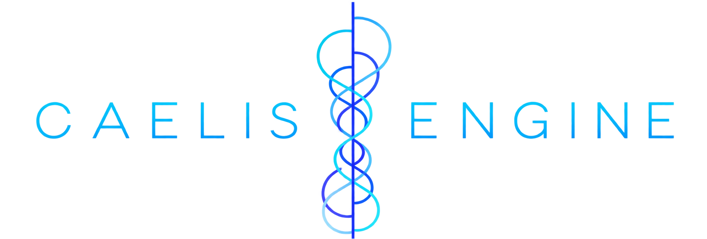
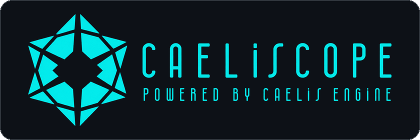
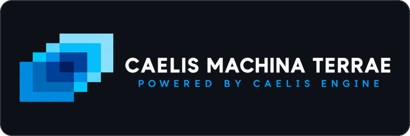
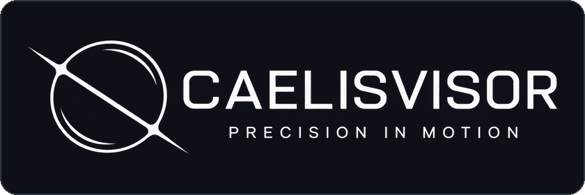
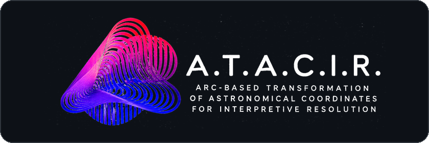
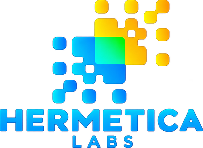

<p align="center">
  
</p>

<h1 align="center">Caelis Engine</h1>

<p align="center">
  Deterministic astronomical computation engine for JavaScript.<br>
  VSOP87B + ELP/MPP02-LLR · No server · No API key · No dependencies
</p>

<p align="center">
  <a href="https://www.npmjs.com/package/caelis-engine"></a>
  <a href="https://www.npmjs.com/package/caelis-engine"></a>
  <a href="https://github.com/HermeticaLabs/caelis-engine/stargazers"></a>
  <a href="https://github.com/HermeticaLabs/caelis-engine/blob/main/LICENSE"></a>
  <a href="https://hermeticalabs.github.io/caelis-engine/"></a>
  <a href="https://github.com/HermeticaLabs/caelis-engine/actions/workflows/validate.yml"></a>
</p>

<p align="center">
  <b>English</b> · <a href="https://github.com/HermeticaLabs/caelis-engine/blob/main/README.es.md">Español</a>
</p>

> **Engine v4.0.13 · Schema v3.1** — independent version numbers. Schema v3.1 defines the output contract and is stable across engine patches.
>
> **What changed in v4.0.13:** improved dynamic ΔT (Delta T) mathematics, and a sidereal-time correction: `gast()` now uses UT1 for the Earth-rotation term (earlier versions fed it a TT value, an offset of ΔT × the sidereal rate, about 0.29° today). `meta.sidereal.gast_deg`, `lst_deg` and the values derived from them (such as horizontal coordinates) change accordingly. This altered some engine mechanics.
>
> **Documentation status:** the `docs/` folder is being audited and updated to reflect the v4.0.13 changes, which are not yet documented. The documentation will be published once v4.0.13 is stabilized, without a version change. Until then, the source code and the validation suite are the reference.
>
> **Upgrade note:** versions ≤ 4.0.7 contain an arcminute→degree unit error in atmospheric refraction that inflated `alt_apparent_deg` (fixed in v4.0.8). See [`CHANGELOG.md`](https://github.com/HermeticaLabs/caelis-engine/blob/main/CHANGELOG.md) for the full release history.

**Every number this engine produces can be traced back to a known astronomical model, with declared precision and zero hidden assumptions.**

Caelis Engine is a deterministic computation engine for celestial data. It replaces opaque APIs and black-box calculations with a fully auditable, reproducible, self-contained system — running entirely in the browser or Node.js, with no server, no API key, no ephemeris files, and no dependencies.

```json
{
  "schema_version": "3.1",
  "meta": {
    "jd_tt": 2461193.499437,
    "frame": {
      "planets":  "VSOP87B (Bretagnon & Francou 1987)",
      "moon":     "ELP/MPP02-LLR · 164L+105B+29R terms",
      "nutation": "IAU 2000B · 77 luni-solar terms"
    }
  },
  "bodies": {
    "Sol":     { "lon_ecl_geocentric_deg": 71.498, "alt_geometric_deg": -27.896, "above_horizon": false },
    "Luna":    { "lon_ecl_geocentric_deg": 269.330, "lon_ecl_topocentric_deg": 270.082, "dist_km": 388954 },
    "Jupiter": { "lon_ecl_geocentric_deg": 114.254, "alt_geometric_deg": 8.267, "above_horizon": true }
  }
}
```

---

## The problem

Most platforms working with celestial data rely on:

- Third-party APIs with opaque internal logic
- Results that cannot be audited or reproduced independently
- Infrastructure costs that scale with usage
- A dependency you don't control — and can't inspect

When something returns the wrong number, you have no way to know why. When the API changes, your product breaks. When the service goes down, so do you.

---

## The solution

Caelis Engine gives you full ownership of your celestial computation layer.

- **Deterministic** — same input, same output. Always. Provably.
- **Auditable** — every algorithm declared in `meta.frame`. Every number traceable to its source.
- **Self-contained** — runs in the browser, in Node.js, in edge functions, offline. No backend required.
- **Schema-stable** — versioned JSON outputs with long-term compatibility guarantees.
- **Zero dependencies** — one JavaScript file. No install, no build step, no network.

This is not an API. It is a protocol — with a contract, invariants, and verifiable guarantees.

It is what products are built on.

---

## Who builds with Caelis Engine

**Positional applications** — any product that needs real planetary and lunar positions without subscription costs or rate limits. Runs 100% offline on the user's device. No data leaves the client.

**Astronomy and educational tools** — observational planning, sky simulators, interactive planetariums. Deterministic output means reproducible results across every device, every run.

**Data infrastructure and AI pipelines** — any system where celestial data must be consistent, traceable, and unambiguous. No null fields, no implicit states.

**Games and interactive experiences** — procedural sky systems, lunar calendar logic, celestial mechanics. Single-file distribution. Works offline. No build step required.

---

## Built with Caelis Engine

Live demos and applications built on top of the engine, each in its own repository.

| | Project | Status |
|---|---|---|
| <a href="https://github.com/HermeticaLabs/Caeliscope"></a> | <a href="https://github.com/HermeticaLabs/Caeliscope"><b>Caeliscope</b></a><br>Immersive sky viewer: fly from space to any point on Earth and look up. First technical proof built on Caelis Engine. | Available |
| <a href="https://github.com/HermeticaLabs/caelis-maquina-terrae"></a> | <a href="https://github.com/HermeticaLabs/caelis-maquina-terrae"><b>Caelis Maquina Terrae</b></a><br>Armillary-sphere application showing layers synchronized with Caelis Engine: magnetic (MMW), telluric (USGS), hydric, ice, solar wind, and more. | Coming soon |
| <a href="https://github.com/HermeticaLabs/CaelisVisor"></a> | <a href="https://github.com/HermeticaLabs/CaelisVisor"><b>CaelisVisor</b></a><br>Celestial tracking designed for telescopes and mounts. | Coming soon |
| <a href="https://github.com/HermeticaLabs/caelis-shadow-and-light"></a> | <a href="https://github.com/HermeticaLabs/caelis-shadow-and-light"><b>Caelis Shadow &amp; Light</b></a><br>Solar light and shadow visualizer for urban terrain, with light analysis tools. | Coming soon |
| <a href="https://github.com/HermeticaLabs/ATACIR"></a> | <a href="https://github.com/HermeticaLabs/ATACIR"><b>A.T.A.C.I.R.</b></a><br>Derived-calculations module (astrological layer) built on Caelis Engine snapshots. Independent project. | Coming soon |

---

## Architecture

```
TimeEngine → AstroCore
```

Two layers. One direction. Strict separation of concerns.

### TimeEngine

The only module that reads `Date.now()`. Computes JD, ΔT, GAST, LST, observer state. Every other module receives time as an explicit parameter.

### AstroCore

Receives time from TimeEngine. Computes the physical state of the solar system. Returns a pure astronomical snapshot — schema v3.1.

Zero interpretive concepts. The engine does not interpret the sky. It measures it.

Interpretation belongs to the applications built on top of the engine, never to the engine itself.

---

## What it computes

Precision figures below are the algorithmic bounds published for each underlying astronomical model (VSOP87B, ELP/MPP02-LLR, etc.) — not a measurement of this implementation's accuracy. Validated implementation accuracy will be documented with methodology and results once the documentation audit is complete (see the status note at the top).

| Computation             | Algorithm                                                                           | Algorithmic precision bound |
|-------------------------|-------------------------------------------------------------------------------------|-----------------------------|
| Planets Mercury–Neptune | VSOP87B (Bretagnon & Francou 1987)                                                  | < 1′                        |
| Moon position           | ELP/MPP02-LLR · 164L+105B+29R terms                                                 | < 10″                       |
| Nutation                | IAU 2000B · 77 luni-solar terms                                                     | < 1 mas                     |
| Obliquity               | IAU 2006 (Capitaine et al.)                                                         | < 0.001°                    |
| Light-time correction   | Iterative · C = 173.14 AU/day                                                       | —                           |
| Annual aberration       | κ = 9.9365×10⁻⁵ rad                                                                 | —                           |
| Lunar parallax          | Full topocentric · WGS-84                                                           | max ~57′                    |
| Atmospheric refraction  | Sæmundsson (1986) · inverse of Bennett (1982), agrees within ~0.1′ · ISA atmosphere | ±0.1′ > 15°                 |
| ΔT                      | Espenak & Meeus (2006) polynomials before 1973 · USNO observed/predicted table 1973–2150 · continuous parabolic tail after 2150 | —                           |
| Sidereal time           | GAST IAU 2006 · UT1 for Earth rotation, TT for polynomial and nutation | —                           |
| Lunar nodes             | Meeus Ch.47                                                                         | —                           |

Every snapshot contains both geometric and apparent altitude. Every field names its own coordinate frame. Every algorithm is declared in `meta.frame`.

---

## Installation

```bash
npm install caelis-engine
```

Or use the single-file reference implementation: [`caelis-minimal.html`](https://github.com/HermeticaLabs/caelis-engine/blob/main/caelis-minimal.html) — open with any local server, no install required.

> **API modes:**
>
> - `setObserver()` + `getSnapshot()` — stateful convenience API. Observer configured once, called repeatedly. Not pure in the functional sense — depends on global state.
> - `getSnapshotAt(jd_tt, observer)` — explicit deterministic API. No global state. Same arguments always produce the same output.

## Quick start

### Option A — Single file

Download `caelis-minimal.html` from this repository and open it with a local server:

```bash
python -m http.server 8080
# open http://localhost:8080/caelis-minimal.html
```

No installation. No dependencies. No build step.

### Option B — Node.js or bundler

```js
import { getSnapshot, getSnapshotAt, setObserver }
  from 'caelis-engine';

// Set observer — Santiago, Chile
setObserver(-33.45, -70.66);

// Current celestial state
const snapshot = getSnapshot();

console.log(snapshot.bodies.Sol.lon_ecl_geocentric_deg);  // ecliptic longitude
console.log(snapshot.bodies.Sol.alt_geometric_deg);       // geometric altitude
console.log(snapshot.bodies.Luna.dist_km);                // lunar distance
console.log(snapshot.meta.obliquity.true_deg);            // true obliquity
console.log(snapshot.meta.frame.planets);                 // algorithm declaration
```

### Option C — Any epoch, any location

```js
// J2000.0 from London — fully deterministic
const j2000 = getSnapshotAt(2451545.0, { lat_deg: 51.5, lon_deg: -0.1 });

// 1987-Apr-10 from Paris — Meeus Ch.25 reference epoch
const meeus = getSnapshotAt(2446895.5, { lat_deg: 48.8, lon_deg: 2.3 });
```

---

## Output schema v3.1

The schema is the contract. Stable, versioned, and guaranteed not to break between minor releases.

```json
{
  "schema_version": "3.1",
  "meta": {
    "jd_tt":       2461193.499437,
    "jd_utc":      2461193.498636,
    "utc":         "2026-06-01T23:58:02.191Z",
    "delta_t_sec": 69.17,
    "observer":    { "lat_deg": -33.45, "lon_deg": -70.66 },
    "frame": {
      "nutation":                "IAU 2000B (77 luni-solar terms + fixed planetary offsets, Mathews et al. 2002)",
      "obliquity":               "IAU 2006 (Capitaine et al. 2006)",
      "planets":                 "VSOP87B (Bretagnon & Francou 1987) + Meeus App.II",
      "moon":                    "ELP/MPP02-LLR (Chapront & Francou 2002) 164L+105B+29R",
      "delta_t":                 "Espenak & Meeus (2006) polynomials before 1973 AD + USNO observed/predicted table 1973-2150 AD + parabola anchored to the table after 2150 AD",
      "aberration":              "Annual (κ=9.9365e-5, Meeus Ch.23)",
      "refraction":              "Saemundsson (1986), ISA standard atmosphere",
      "above_horizon_criterion": "geometric (unrefracted)"
    },
    "sidereal":  { "gast_deg": 249.98872, "lst_deg": 179.32872 },
    "obliquity": { "mean_deg": 23.435843, "true_deg": 23.437975 },
    "nutation":  { "delta_psi_arcsec": 6.6344, "delta_eps_arcsec": 7.6757 }
  },
  "bodies": {
    "Sol": {
      "ra_deg":                 69.959,
      "dec_deg":                22.160,
      "lon_ecl_geocentric_deg": 71.499,
      "lat_ecl_geocentric_deg": -0.00012,
      "alt_geometric_deg":      -27.659,
      "alt_apparent_deg":       -27.659,
      "az_deg":                 279.448,
      "above_horizon":          false,
      "dist_au":                1.01404
    },
    "Luna": {
      "lon_ecl_geocentric_deg":  269.330,
      "lon_ecl_topocentric_deg": 270.082,
      "alt_geometric_deg":       14.160,
      "alt_apparent_deg":        14.225,
      "dist_km":                 406120
    }
  },
  "luna": {
    "phase_ratio":  0.894,
    "phase_deg":    160.99,
    "illumination": 0.973
  }
}
```

> The example above is real output of Caelis Engine v4.0.13 (schema v3.1) for `jd_tt` 2461193.499437 and the observer shown. Relative to v4.0.12, v4.0.13 changes `delta_t_sec`, the nutation (`delta_psi_arcsec`, `delta_eps_arcsec`), the sidereal fields (`gast_deg`, `lst_deg`) and every quantity derived from them, such as altitude and azimuth. The structure is unchanged. The full specification is part of the documentation currently under audit.

---

## Why not a third-party API or Swiss Ephemeris?

|                                 | Third-party APIs | Swiss Ephemeris | **Caelis Engine** |
|---------------------------------|:----------------:|:---------------:|:-----------------:|
| Runs in browser                 | ✗                | ✗               | **✓**             |
| No server required              | ✗                | ✗               | **✓**             |
| No API key or cost              | ✗                | ✓               | **✓**             |
| Declared precision per field    | ✗                | partial         | **✓**             |
| Algorithm named in every output | ✗                | ✗               | **✓**             |
| Single JS file · no install     | ✗                | ✗               | **✓**             |
| Offline capable                 | ✗                | ✓               | **✓**             |
| Schema-stable versioned output  | ✗                | ✗               | **✓**             |

Third-party APIs add latency, cost, and a dependency you don't control. Swiss Ephemeris is the precision standard — but it requires a server, a C wrapper, and ephemeris files.

Caelis Engine runs where neither can: directly in the browser, in edge functions, in React Native, in any JavaScript environment. Offline. Deterministically.

---

## Validation

```bash
node validation/run.js
```

The validation suite checks the engine against published reference epochs and schema invariants:

| Epoch / group                              | Source                                  |
|--------------------------------------------|-----------------------------------------|
| J2000.0 — 2000-Jan-01 12:00 TT             | IAU SOFA + VSOP87 paper                 |
| 1987-Apr-10 (Meeus Ch.25)                  | Meeus *Astronomical Algorithms* 2nd ed. |
| 1992-Apr-12 (Meeus Ch.33 Venus)            | VSOP87 verification table               |
| 2026-Jun-01 regression baseline            | Caelis v4.0 canonical output            |
| Schema v3.1 invariants                     | Architecture contract                   |
| Atmospheric refraction regression          | Sæmundsson formula, arcmin→deg          |

---

## Precision and limitations

Designed for portability and auditability — not sub-arcsecond astrometry.

| Source                    | Declared max error |
|---------------------------|--------------------|
| VSOP87B (Uranus, Neptune) | < 1′               |
| ELP/MPP02 (Moon)          | < 10″              |
| IAU 2000B nutation        | < 1 mas            |
| Refraction near horizon   | 1–5′               |
| ΔT outside the observed range (1973–2026.75) | grows with distance from the data; not flagged in the snapshot |

Time scales: the engine has no DUT1 or leap-second tables; UT1 is taken as equal to UTC (|UT1 − UTC| < 0.9 s is neglected).

For sub-arcsecond requirements, use JPL Horizons or Swiss Ephemeris with full VSOP87. For everything that needs to run in a browser, offline, and deterministically — this is it.

---

## Documentation

The technical documentation (`docs/`) is **currently being audited and updated** following recent changes to the engine in v4.0.13 (improved dynamic ΔT mathematics). Those changes altered some mechanics and have not yet been documented.

Once v4.0.13 is stabilized, the audited documentation will be published in this repository **without a version change**.

In the meantime:

- [`CHANGELOG.md`](https://github.com/HermeticaLabs/caelis-engine/blob/main/CHANGELOG.md) — release history
- [`validation/`](https://github.com/HermeticaLabs/caelis-engine/tree/main/validation) — executable validation suite
- [`examples/`](https://github.com/HermeticaLabs/caelis-engine/tree/main/examples) — usage examples
- [Live demo](https://hermeticalabs.github.io/caelis-engine/)

---

## Contributing

Contributions are welcome. See [`CONTRIBUTING.md`](https://github.com/HermeticaLabs/caelis-engine/blob/main/CONTRIBUTING.md).

---

## License

Caelis Engine is released under **AGPL-3.0**.

Free to use in open source software under AGPL-3.0 terms. **If you are building a commercial or proprietary product, you need a commercial license.**

Commercial licensing: `hermeticalabs.dev@proton.me` · Details: [`COMMERCIAL_LICENSE.md`](https://github.com/HermeticaLabs/caelis-engine/blob/main/COMMERCIAL_LICENSE.md)

---

## About

<a href="https://github.com/HermeticaLabs"></a>

Caelis Engine was built by **Cristian Valeria Bravo** under [**Hermetica Labs**](https://github.com/HermeticaLabs).

Two principles guided every decision:

**Compute the sky, not interpret it.** The engine measures physical state. Interpretation is left to the applications built on top of it.

**Zero hidden assumptions.** Every number is traceable. Every algorithm is declared. Every output is reproducible.

---

*Caelis Engine is not the product. It is what products are built on.*

---

*Caelis Engine v4.0.13 · Hermetica Labs · © 2024–2026 Cristian Valeria Bravo*
